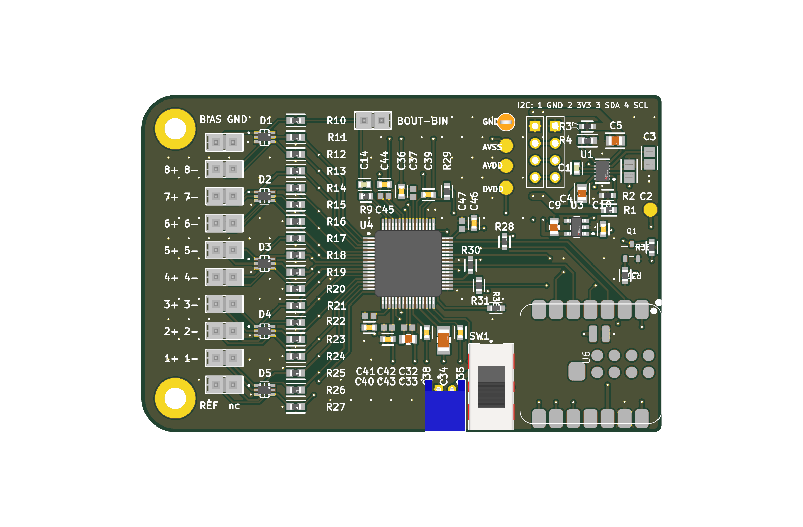
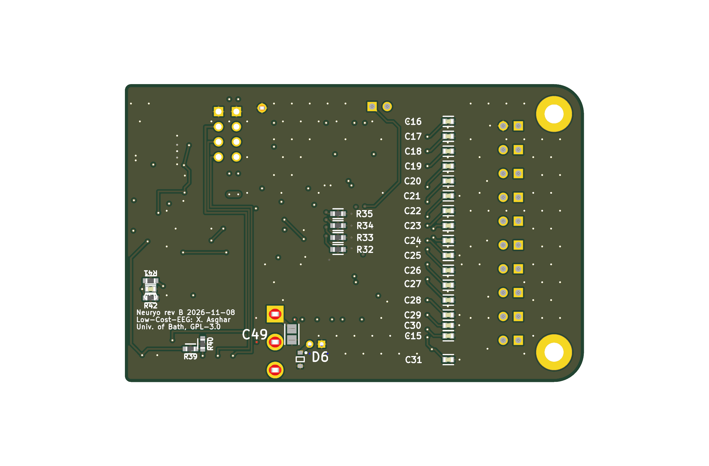

# Neuryo rev B (KiCad 10)

The Low-Cost-EEG board (commit `3730d31`) with its ESP32-S3 module side replaced by a Seeed XIAO ESP32-S3, the review changes from `../README.md`, I²C headers for the earlobe MAX30102 and a BMI270, and a 77 × 50 mm outline for the v6 left pod. **Not ordered; waiting for review.**

| Path | What it is |
|---|---|
| `Neuryo_RevB.kicad_pro` / `.kicad_sch` / `.kicad_pcb` / `.kicad_dru` | The rev B project (KiCad 10.0.8). Zones are filled. |
| `Neuryo_RevB.pretty`, `Neuryo_RevB.kicad_sym` | New footprints and symbols: Seeed XIAO-ESP32-S3-SMD (from Seeed's library), SOT-23 2N7002, 1×4 header, PWR_FLAG |
| `Low_Cost_EEG-import-fps.pretty` | Footprints imported from the reference |
| [CHANGES.md](CHANGES.md) | Every change, why, its source, and whether it is verified |
| [REVIEW-CHECKLIST.md](REVIEW-CHECKLIST.md) | What to check before ordering |
| `baseline-import/` | The reference imported into KiCad unchanged (plus the translated Altium clearance rules), for side-by-side comparison |
| `review/` | Renders (`top.png`, `bottom.png`), `schematic.pdf`, `layers.pdf`, ERC/DRC JSON, netlists, the netlist and copper diffs, the baseline's reports, and a draft fab set (not for ordering) |
| `scripts/` | The scripts that made every edit: `edit_sch.py`, `edit_pcb.py`, `edit_pcb2.py`, plus the checks (`netdiff.py`, `copperdiff.py`, `drcsum.py`) and `runner.sh`, which runs `kicad-cli`. The paths inside them are the build machine's. |

